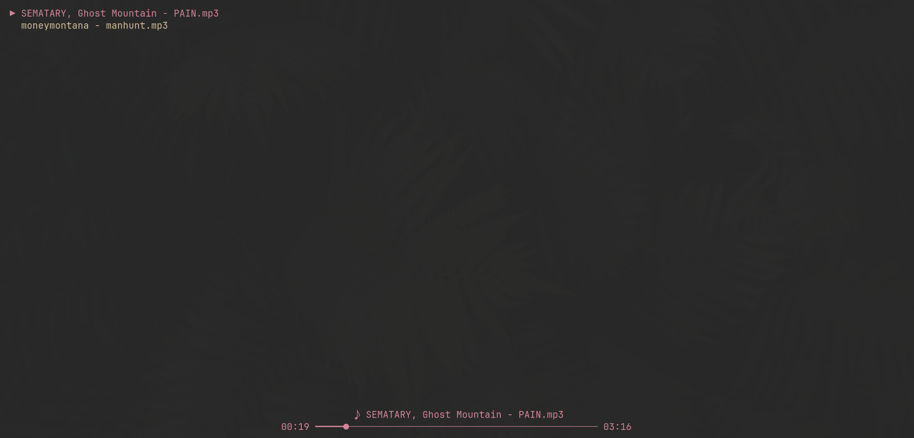

# rmp

<p align="center">
  
</p>


**Is a simple music player written on rust**


# Installation

```bash
git clone https://github.com/divineparanoid/rmp.git
cd rmp/
cargo run 
```


# Help
```bash
:q quit | :c close track | :pause | :play | :vol <0-100> | / search | ←/→ seek
```

# LICENSE
GNU GPLv3.
